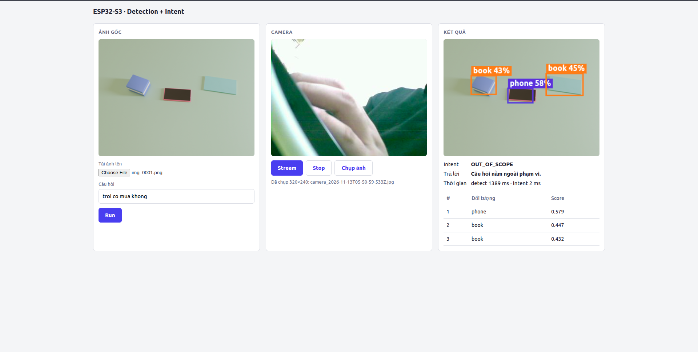
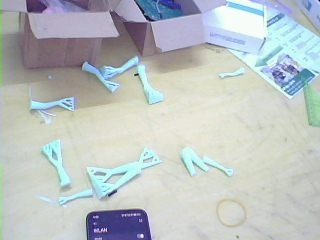
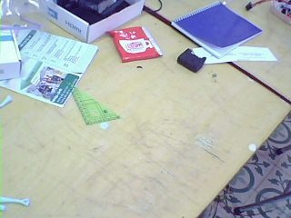
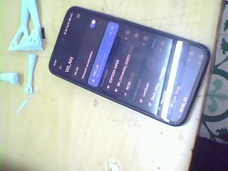

# Edge AI Challenge 2026: Baseline ESP32-S3 (Detection + Intent)

[](https://colab.research.google.com/github/clbpioneer/edge-ai-challenge-2026-baseline/blob/main/baseline.ipynb)
[](https://docs.espressif.com/projects/esp-idf/en/stable/esp32s3/)
[](LICENSE)

Baseline cho các đội thi: phát hiện đồ vật (CNN int8) và phân loại ý định câu hỏi (TextCNN int8)
chạy **hoàn toàn trên ESP32-S3** bằng TFLite Micro, kèm web server để thử trực tiếp từ trình duyệt.



*Giao diện web do ESP32-S3 phát. **Ảnh gốc**: `img_0001.png` của dataset kèm câu hỏi "troi co mua khong".
**Camera**: hình OV7670 live. **Kết quả**: 3 đối tượng (phone 0.58, book 0.45, book 0.43), intent `OUT_OF_SCOPE`
nên câu trả lời là "Câu hỏi nằm ngoài phạm vi". Thời gian đo trên board: detect 1389 ms, intent 2 ms.*

```
Trình duyệt ──(ảnh 320×240 RGB + câu hỏi)──► ESP32-S3 /run
                                              ├─ Detection CNN (grid 15×20, 7 class) → box + NMS
                                              ├─ TextCNN (32 token, 5 intent)
                                              └─ Trả lời theo intent + kết quả detection
Trình duyệt ◄──────────── JSON ───────────────┘   (vẽ bounding box, danh sách đối tượng, intent, câu trả lời)
```

- **Class:** `bottle cup phone book mouse box toy_car`
- **Intent:** `COUNT EXIST LIST LOCATION OUT_OF_SCOPE`
- **Tốc độ trên ESP32-S3 (240 MHz):** detection khoảng 1.4 s/ảnh, intent khoảng 2 ms/câu.
- Repo đã kèm trọng số baseline trong `main/models/`, clone về là build và flash được ngay.
- Camera OV7670 là tùy chọn: có thì web hiện khung camera live và nút chụp ảnh. Camera **chưa** nối vào model,
  phần này để các đội tự phát triển (xem [Camera](#camera-ov7670-tùy-chọn)).

## Mục lục
- [Phần cứng](#phần-cứng)
- [Build và flash](#build-và-flash)
- [Dùng web](#dùng-web)
- [API (cho script chấm hoặc test tự động)](#api-cho-script-chấm-hoặc-test-tự-động)
- [Train và thay model của đội](#train-và-thay-model-của-đội)
- [Cấu trúc](#cấu-trúc)
- [Camera OV7670](#camera-ov7670-tùy-chọn)
- [Lỗi thường gặp](#lỗi-thường-gặp)

## Phần cứng

- **ESP32-S3 có PSRAM** (bắt buộc: tensor arena detection khoảng 1.5 MB). Đã cấu hình cho module **N16R8 / N8R8 (PSRAM Octal)**.
  Board PSRAM Quad: trong `sdkconfig.defaults` đổi `CONFIG_SPIRAM_MODE_OCT=y` thành `CONFIG_SPIRAM_MODE_QUAD=y`.
- Flash ≥ 4 MB.
- (Tùy chọn) Camera OV7670 không FIFO.

## Build và flash

Cần [ESP-IDF](https://docs.espressif.com/projects/esp-idf/en/stable/esp32s3/get-started/) ≥ 5.1 (đã thử v5.5).
Các component `esp-tflite-micro`, `esp-nn`, `esp32-camera` được tự tải khi build.

```bash
git clone https://github.com/clbpioneer/edge-ai-challenge-2026-baseline.git
cd edge-ai-challenge-2026-baseline
idf.py set-target esp32s3
idf.py menuconfig          # ESP32-S3 Infer → WiFi SSID / password
idf.py -p /dev/ttyACM0 flash monitor     # Windows: -p COMx
```

- Để trống SSID (hoặc kết nối WiFi lỗi) thì ESP tự phát WiFi **`ESP32S3-INFER`**, mật khẩu `12345678`, rồi mở http://192.168.4.1/
- Kết nối WiFi nhà thì mở địa chỉ IP in ra trong log.

Log khởi động đúng sẽ có:
```
infer: detection OK | arena dung ... KB
infer: textcnn OK | arena dung ... KB
infer: vocab 261 tu
```

## Dùng web

Trang có 3 khung trên cùng một hàng (ảnh ở đầu README):

| Khung | Chức năng |
|---|---|
| **Ảnh gốc** | Tải ảnh lên (định dạng nào cũng được, trình duyệt tự resize về 320×240), nhập câu hỏi, bấm **Run** |
| **Camera** | Hình OV7670 live (nếu có camera), nút Stream / Stop / **Chụp ảnh** (lưu file .jpg về máy) |
| **Kết quả** | Ảnh kèm bounding box, intent, câu trả lời, thời gian chạy, bảng đối tượng và score |

Câu hỏi gõ có dấu hay không dấu đều được, trình duyệt tự bỏ dấu vì vocab của TextCNN không dấu.

## API (cho script chấm hoặc test tự động)

`POST /run`: body = **230400 byte RGB888** (320×240, theo hàng, R G B) **+ câu hỏi ASCII không dấu** (tối đa 512 byte, có thể rỗng).

```json
{"ms_det": 1389, "ms_intent": 2,
 "dets": [{"c": "phone", "s": 0.579, "b": [0.42, 0.42, 0.58, 0.55]}],
 "intent": "OUT_OF_SCOPE", "answer": "Câu hỏi nằm ngoài phạm vi."}
```
`b` = `[x1, y1, x2, y2]` chuẩn hóa 0..1. Ví dụ Python:

```python
import requests, numpy as np
from PIL import Image
rgb = np.asarray(Image.open("img.png").convert("RGB").resize((320, 240)), np.uint8).tobytes()
print(requests.post("http://192.168.4.1/run", data=rgb + b"Co bao nhieu coc trong anh?").json())
```

Stream camera: `GET http://<ip>:81/stream` (MJPEG).

## Train và thay model của đội

`baseline.ipynb` chạy trên Google Colab (GPU T4), từ trên xuống. [Mở trong Colab](https://colab.research.google.com/github/clbpioneer/edge-ai-challenge-2026-baseline/blob/main/baseline.ipynb).

| Phần | Nội dung | Sinh ra |
|---|---|---|
| Chuẩn bị | `gdown` tải dataset, giải nén vào `egde-ai-challenge-2026-lan-2-qualifiers/`, cài thư viện | |
| 1. Detection | Thống kê class, dataloader grid 15×20, model CNN, train (mAP@50, F1), export int8 qua onnx2tf, chạy thử và vẽ box | `model_int8.tflite`, `det_model.cc/.h` |
| 2. Intent | Tách từ + vocab, TextCNN, train, export int8 **qua Keras** (không qua onnx2tf), in danh sách op, so độ chính xác float và INT8 | `textcnn_int8.tflite`, `textcnn_model.cc/.h`, `vocab.cc/.h` |

Copy các file `.cc/.h` vào `main/models/` (hoặc đặt `cc_dir` trong ô export), rồi chạy `idf.py build flash`.

Ô cuối của phần 2 xuất `vocab.cc/.h` (`vocab[k]` có id `k+2`; 0 = pad, 1 = từ lạ). Đổi dữ liệu hoặc cách tách từ thì
phải copy cả `vocab.cc/.h` mới cùng với `textcnn_model.cc/.h`, nếu không token id trên ESP sẽ lệch với model.

Ràng buộc để chạy được trên ESP (chi tiết trong `main/models/README.md`):
- Detection: input int8 `1×240×320×3` (RGB/255), output NHWC `1×15×20×(5+7)`.
- TextCNN: input `1×32` **int32**, output int8 `1×5`.
- Chỉ dùng op mà TFLite Micro hỗ trợ và đã đăng ký trong `REGISTER_OPS` (`main/model_config.h`).
  Thiếu op thì log báo `Didn't find op for builtin opcode ...`: thêm op vào `REGISTER_OPS`.

> **Đừng export TextCNN qua onnx2tf.** onnx2tf chèn `SELECT`/`CAST int64` khi gặp embedding (TFLite Micro không có),
> và nối sai trục khi độ dài câu = số chiều embedding (= 32). TFLite trên PC vẫn chạy đúng nên rất khó phát hiện.
> Ô export trong notebook dựng lại model bằng Keras rồi chép trọng số từ PyTorch.

## Cấu trúc

```
baseline.ipynb          train + export int8 + .cc/.h (Colab)
main/
  main.c                WiFi, HTTP server (/ và /run)
  infer.cc/.h           TFLite Micro: nạp 2 model, chạy detect / intent
  logic.c/.h            hậu xử lý thuần C: decode grid, NMS, tokenize, câu trả lời
  model_config.h        tên mảng model, kích thước arena, ngưỡng conf/NMS, REGISTER_OPS
  cam.c/.h              camera OV7670 + MJPEG stream cổng 81
  index.html            giao diện web (được nhúng vào firmware)
  models/               trọng số dạng mảng C (.cc/.h)
assets/                 ảnh minh họa cho README
test/test_logic.c       test hậu xử lý trên máy tính
```

Test logic C trên máy tính (không cần board):
```bash
gcc -I main test/test_logic.c main/logic.c -lm -o /tmp/t && /tmp/t
```

## Camera OV7670 (tùy chọn)

### Sơ đồ nối chân

| OV7670 | ESP32-S3 | Ghi chú |
|--------|----------|---------|
| 3.3V   | 3V3      | |
| GND    | GND      | |
| SDA    | GPIO16   | SCCB data |
| SCL    | GPIO17   | SCCB clock |
| XCLK   | GPIO12   | ESP32-S3 cấp clock cho camera |
| PCLK   | GPIO13   | |
| HREF   | GPIO15   | |
| VSYNC  | GPIO14   | |
| D0     | GPIO4    | |
| D1     | GPIO5    | |
| D2     | GPIO6    | |
| D3     | GPIO7    | |
| D4     | GPIO8    | |
| D5     | GPIO9    | |
| D6     | GPIO10   | |
| D7     | GPIO11   | |
| RST    | 3.3V     | nối cứng, không dùng GPIO |
| PWDN   | GND      | nối cứng, không dùng GPIO |

Các chân này không trùng với chân PSRAM Octal (GPIO33–37) của module N16R8 / N8R8.

### Ảnh mẫu từ camera

Ảnh chụp thật bằng nút **Chụp ảnh** trên web (OV7670, QVGA 320×240, chưa qua xử lý):

| | |
|---|---|
|  |  |
| *Mặt bàn: hộp giấy, chi tiết in 3D, điện thoại ở mép dưới* | *Mặt bàn: sổ tay, giấy tờ, thước tam giác, gói đồ màu đỏ* |
|  |  |
| *Điện thoại trên bàn (class `phone`), góc chụp nghiêng* | *Sàn gạch hoa văn và chân ghế, không có đối tượng nào* |

Ảnh OV7670 bị ám màu, nhiễu và chụp ở góc khác hẳn ảnh dataset, nên dùng camera để detect có thể kém hơn nhiều so với
chạy trên ảnh test. Các đội muốn dùng camera nên cân nhắc thu thêm dữ liệu từ chính camera này.

### Ghi chú

- Đổi chân: sửa `CAM_PIN_*` trong `main/cam.c`. XCLK, CLKRC, chất lượng JPEG: chỉnh trong `menuconfig`.
- Không có camera thì firmware vẫn chạy bình thường, web báo "Không có camera".
- Lúc khởi động có nhiều dòng `I2C transaction unexpected nack`: đó là driver dò các loại cảm biến khác, **không phải lỗi**.
- Camera chạy QVGA 320×240 RGB565, **đúng bằng input của model detection**. Để ghép camera vào model:
  `esp_camera_fb_get()` → đổi RGB565 (big-endian) sang RGB888 → `infer_detect()` / `infer_intent()` / `make_answer()` như trong `run_post` (`main/main.c`).

## Lỗi thường gặp

| Log | Cách xử lý |
|---|---|
| `AllocateTensors loi` + `Didn't find op ...` | Thêm op vào `REGISTER_OPS` (`main/model_config.h`) |
| `detection: can input int8 1x240x320x3 ...` | Model detection sai shape hoặc sai số class |
| `Thieu main/models/... ` khi build | Chưa copy đủ các file `.cc/.h` vào `main/models/` |
